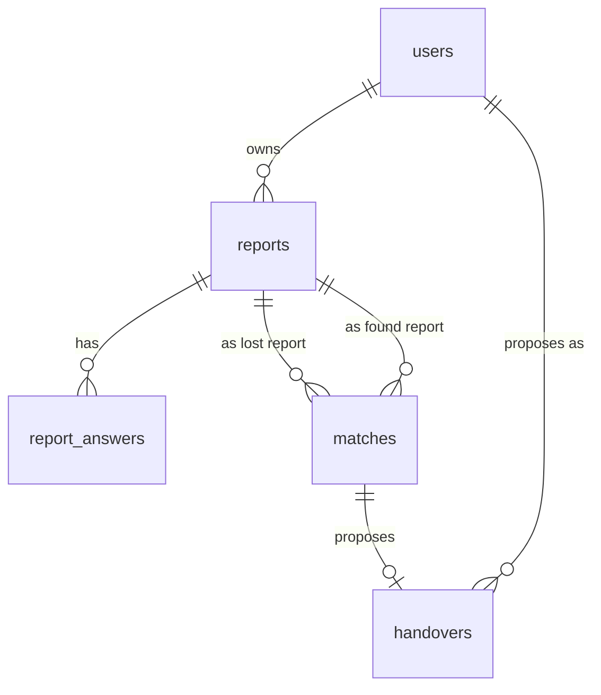
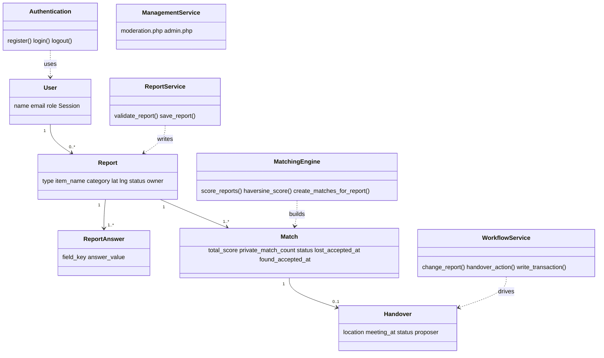
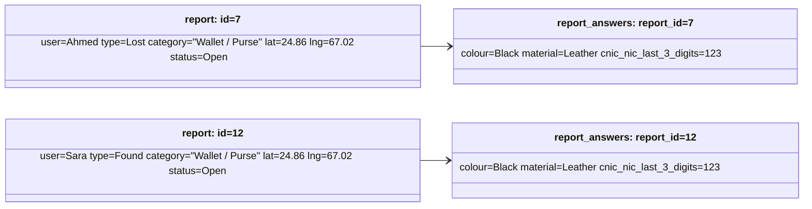
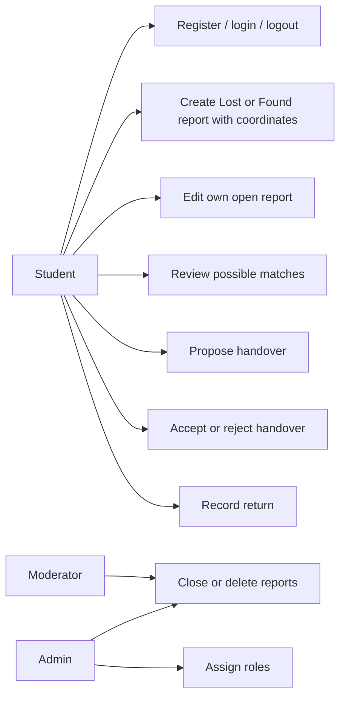
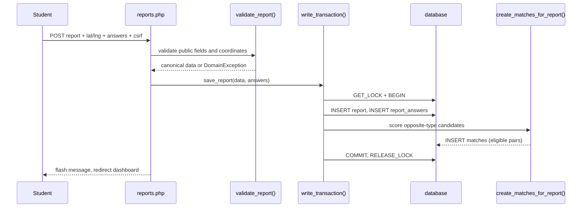
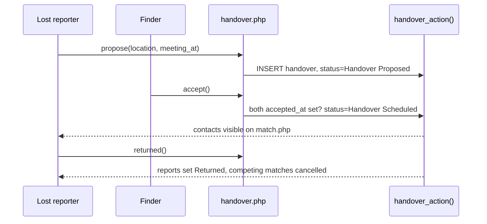

# Analysis Modelling

Where Is My Stuff? GPS-enabled Lost and Found System. CS-326 evidence for data, object, and behavioural modelling.

Source of truth: `database.sql` (tables), `workflow.php` and `matching.php` (behaviour), `match.php` (handover page). All diagrams below match the implemented code.

## 1. Data model

### 1.1 Entity-relationship diagram

A match always pairs one Lost report with one Found report. The `UNIQUE (lost_report_id, found_report_id)` constraint stops duplicate pairs, and `UNIQUE (report_id, field_key)` keeps one answer per private field.

### 1.2 Data dictionary

| Table | Column | Type | Notes |
|---|---|---|---|
| users | id | INT UNSIGNED PK | |
| users | name | VARCHAR(100) | |
| users | email | VARCHAR(150) UNIQUE | |
| users | password_hash | VARCHAR(255) | bcrypt |
| users | role | ENUM(Student, Moderator, Admin) | Default Student |
| users | created_at | TIMESTAMP | |
| reports | id | INT UNSIGNED PK | |
| reports | user_id | FK users | ON DELETE CASCADE |
| reports | type | ENUM(Lost, Found) | Report type, not a role |
| reports | item_name | VARCHAR(120) | Display title; does not affect score |
| reports | category | VARCHAR(80) | Must match one of ITEM_CATEGORIES |
| reports | description | TEXT | Public, contact-free text |
| reports | location | VARCHAR(100) | Required free-text place name |
| reports | lat | DECIMAL(10,8) NULL | Required by validate_report() |
| reports | lng | DECIMAL(11,8) NULL | Required by validate_report() |
| reports | location_description | VARCHAR(255) | |
| reports | event_date | DATE | Stored as Y-m-d |
| reports | contact | VARCHAR(120) | Released only after mutual acceptance |
| reports | status | ENUM(Open, Closed, Returned) | |
| reports | created_at / updated_at | TIMESTAMP | Index: (type, category, status, user_id) |
| report_answers | id | INT UNSIGNED PK | |
| report_answers | report_id | FK reports | CASCADE, UNIQUE(report_id, field_key) |
| report_answers | field_key | VARCHAR(60) | Derived from questionnaire label |
| report_answers | answer_value | VARCHAR(80) | Normalised select or masked suffix |
| matches | id | INT UNSIGNED PK | |
| matches | lost_report_id / found_report_id | FK reports | CASCADE, UNIQUE pair |
| matches | total_score | TINYINT UNSIGNED | Maximum 100 |
| matches | category_score / location_score | TINYINT UNSIGNED | Max 20 each |
| matches | date_score | TINYINT UNSIGNED | Max 15 |
| matches | description_score | TINYINT UNSIGNED | Max 15 |
| matches | private_score | TINYINT UNSIGNED | Max 30 |
| matches | private_match_count | TINYINT UNSIGNED | At least 2 needed |
| matches | status | ENUM(Possible Match, Handover Proposed, Handover Scheduled, Returned, Rejected) | |
| matches | lost_accepted_at / found_accepted_at | DATETIME NULL | Both set before Scheduled |
| handovers | id | INT UNSIGNED PK | |
| handovers | match_id | FK matches | UNIQUE handover per match |
| handovers | proposer_id | FK users | |
| handovers | location | VARCHAR(255) | Free-form meeting point |
| handovers | meeting_at | DATETIME | Must be current or future |
| handovers | status | ENUM(Proposed, Scheduled, Rejected, Completed) | |

## 2. Object model

The implementation is procedural PHP, so the object model is expressed as a domain model with entity classes and service modules that map one-to-one onto source files.

### 2.1 Object diagram (exemplar pair)

A concrete Wallet / Purse pair that scores 100 after matching:

## 3. Behavioural models

### 3.1 Use-case diagram

### 3.2 Report creation sequence (includes matching)

### 3.3 Handover sequence (mutual acceptance)

### 3.4 State diagrams

Report and match states are specified in matching-architecture.md and implemented in workflow.php (`handover_action`) and `change_report`. Rejected pairs stay Rejected; an edit only removes stale `Possible Match` rows and never revives a rejected pair (matching.php `create_matches_for_report`).

## 4. Model validation against requirements

| Model | Requirements it validates | Result |
|---|---|---|
| ER diagram | FR-03, FR-05, FR-09 data needs | 5 entities, 4 relationships, all FK-safe |
| Data dictionary | FR-02b (lat/lng), FR-03, FR-04s, FR-08 (handover text) | Columns present in database.sql |
| Class diagram | Module boundaries FR-06, FR-07 | MatchingEngine and WorkflowService hold no HTML |
| Use-case diagram | FR-01, FR-02, FR-08, FR-09, FR-10 | Every use case maps to a route in router.php |
| Sequence diagrams | FR-05s, FR-08, FR-09 ordering | Ordering matches workflow.php code |
| State model | FR-06, FR-08, FR-09 | States match matches.status ENUM |

## 5. Open items

- A stand-alone Microsoft Visio or draw.io export of the ER and use-case diagrams is still desired for the submission package.
- Ambiguity to resolve for the demo: whether a Closed report should remain matchable after reopening. Current code treats only `Open` reports as candidates.