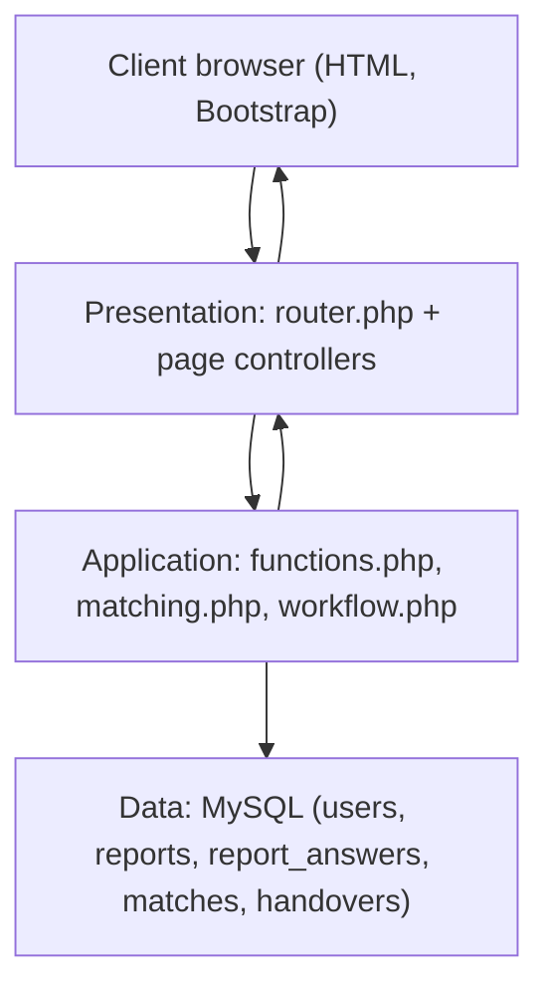

# Software Design Record

Where Is My Stuff? GPS-enabled Lost and Found System. CS-326 evidence for software design, including the general model, architectural design, and applied design patterns.

Companion documents: `architecture.md`, `matching-architecture.md`, `analysis-models.md`, `database.sql`, `ui-wireframes-redesign.png`.

## 1. General design model

The system is organised as a three-layer synchronous web application. Each page is a thin controller that validates input, delegates to a service function, and renders a view.

The presentation layer only calls the `e()` helper for escaping and the `layout_start`/`layout_end` template functions. Scoring logic lives in `matching.php`, workflow writes in `workflow.php`, and validation/helpers in `functions.php`. No business rule is embedded in a view file.

## 2. Architectural design

| Concern | Where it lives | Reason |
|---|---|---|
| Entry and security headers | config.php | Single bootstrap for session, DB, exception handling |
| Routing whitelist | router.php | Only declared pages and assets are served |
| Validation and smoke helpers | functions.php | `validate_report`, `validate_questionnaire_answers`, `validate_public_description` |
| Scoring | matching.php | `score_reports`, `haversine_score`, `create_matches_for_report` |
| Report and handover writes | workflow.php | `save_report`, `change_report`, `handover_action`, `write_transaction` |
| State machine | workflow.php | `handover_action` branches on states from matching-architecture.md |
| Page views | index, report_form, report, match, admin, moderation | Read-only after `require_login`/`require_post` |

### 2.1 Key design decision: named lock plus transaction

`write_transaction()` wraps every report, match, and handover mutation in a MySQL advisory lock followed by a transaction (workflow.php). A proposal cannot race a second proposal into scheduling the same report because the lock serialises concurrent requests and `report_has_locked_match` rejects the second book. This is the architectural response to risk R9.

### 2.2 Key design decision: coordinates required for matching

`validate_report()` requires lat/lng, and `score_reports()` degrades a missing pair to a location score of 0 instead of erroring. This makes the GPS change safe to ship: old reports without coordinates become matchable only on their other factors.

## 3. Applied design patterns

Patterns are light-weight idioms that match the small procedural codebase. Each is verifiable in the listed source location.

| Pattern | Implementation | Source |
|---|---|---|
| Layered architecture | Presentation / application / data layers separated | router.php, functions.php, matching.php, workflow.php |
| Table-driven design | CASE_COLUMN templates drive questionnaire_fields(), validate_questionnaire_answers(), and scoring field count | functions.php QUESTIONNAIRE_TEMPLATES |
| Strategy family | description_score() and haversine_score() plug into score_reports() with a common output contract | matching.php |
| Repository wrapper | `sql()` centralises prepared-statement creation for every query | functions.php |
| Decorator (transaction) | `write_transaction()` adds commit/rollback/lock to an arbitrary operation | workflow.php |
| Template method | `layout_start()` / `layout_end()` fix the page frame; page controllers fill the body | functions.php |
| Data-access object | `report_answer_map()` wraps the field-key/value fetch behind one call | functions.php |

## 4. Module responsibility matrix

| Module | Inputs | Outputs | Dependencies |
|---|---|---|---|
| Authentication (auth.php) | register/login form | session, redirect | users table, password_hash |
| Reports (reports.php, report_form.php, report.php) | POST report | reports + report_answers rows, flash | validate_report, save_report |
| Matching (matching.php) | saved report + candidates | matches rows | score_reports, haversine_score |
| Handover (handover.php, workflow.php) | propose/accept/reject/returned | matches + handovers + reports state | handover_action, write_transaction |
| Management (moderation.php, admin.php) | close/delete/set_role | report and users updates | change_report, role checks |

## 5. Design alternatives considered

| Alternative | Rejected because |
|---|---|
| Exact-match location scoring | Could not express "nearby" for a Karachi-wide scope; replaced by haversine bands (scope-freeze.md) |
| Storing the questionnaire as one JSON blob | Lost normalised comparison and FK integrity; replaced by report_answers rows |
| One global `mysql_*` connection | Not testable in isolation; replaced by `db()` with env-var connection and strict error mode |
| Matching on every visit | Changed to matching during the save transaction, avoiding stale suggestions (risk R4) |

## 6. UI design traceability

Active reference: `ui-wireframes-redesign.png` (backup: `ui-wireframes-redesign.backup.png`). The report form implements the reference's Lost/Found toggle, four-step progress header, grouped report details, and privacy-aware matching section. Wallet / Purse reports use the contents checklist, item-detail accordion, and report-decision wizard (README.md).

## 7. Design validation

The module map in section 4 matches the traceability matrix in `srs.md`. SOLID review and a formal design walkthrough remain open checklist items (SE-checklist.md section 5); a review of the two invariants in 2.1 and 2.2 is the recommended starting point.