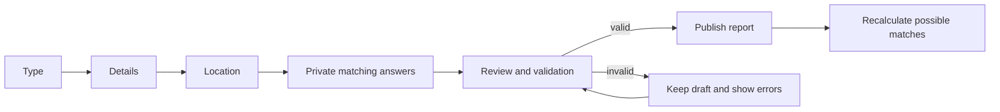

# Where Is My Stuff? — CS-326 Software Engineering Case Study

**Project:** Where Is My Stuff? (`where-is-my-stuff-ui-surprise-v2`)  
**Course reference:** CS-326 Software Engineering, B.E. Computer Systems, batch 2018 onwards  
**Status reviewed:** Local Django implementation; project README says it is not publicly launched.

## 1. Purpose of this document

This report walks through the project as a practical case study against the CS-326 syllabus. It describes the requirements visible in the product, how the implementation is organized, which software-engineering practices can be evidenced in the repository, and what remains limited or incomplete. It is based on the supplied syllabus PDF and a read-through of the project README, application code, templates, architecture notes, migrations, and tests. It is not a claim that the project has been formally audited, deployed for public use, or assessed by the course instructor.

## 2. Course context

The syllabus places **CS-326 Software Engineering** in third-year fall and assigns it **3 theory + 1 practical credit hours**. Its stated topics are basic software concepts and attributes; waterfall, incremental, and reuse-oriented process models; functional, non-functional, and domain requirements; requirements engineering; data, object, and behavioral analysis models; project planning and risk management (including RMMM); software design and architecture; design patterns; XP and Scrum; verification and validation; debugging, inspection, and testing; software quality assurance, measurement, and metrics; cost estimation including COCOMO; and software maintenance.

The same syllabus lists **CS-325 Software Development & Testing** and **CS-435 Software Project Management** as separate electives. They may be useful extensions to this case study, but their content is not attributed here to the core CS-326 course.

## 3. Product overview

Where Is My Stuff? is a Karachi-oriented lost-and-found web application. An account holder can create Lost and Found reports, add an approximate place and map coordinates, answer private item-specific questions, and receive possible matches. Participants can propose and accept a public handover, then record a return. Supporting features include resumable drafts, report history, optional photos, report QR codes, personal QR contact labels, and staff moderation.

The product uses an intentionally limited trust model: an account, match score, or QR scan does not prove ownership or possession. A match is a lead for people to verify in person. This is a meaningful domain constraint because the software coordinates a return but cannot establish the real-world truth of a claim.

### Main users and goals

| User | Goal | Main capabilities |
|---|---|---|
| Reporter | Record a lost or found item and follow progress | Register/login, create and edit reports, add private answers and location, view matches and history |
| Match participant | Coordinate a possible return | Propose, accept, reject, or restore a handover suggestion; confirm return after the scheduled time |
| Staff moderator | Handle reports requiring intervention | Review management list, close or remove eligible open reports; actions create event records |
| QR finder | Start a Found report from a shared Lost-report QR | Sign in, then use public report hints to seed a new draft |
| Personal-label finder | Contact an item's owner | Scan a currently active personal label and see its explicitly published phone number |

## 4. Requirements and observable behavior

The code and project documentation imply the following requirements.

### Functional requirements

1. A person can register and sign in with an email address and password.
2. A person can create a Lost or Found report through a five-step flow: Type, Details, Location, Matching, and Review.
3. A report records a category, item title, event date, public description, contact phone, place, coordinates, optional location detail, optional photo, and private category-specific answers.
4. A draft is saved when a wizard step is submitted and can be resumed. The user must explicitly confirm discarding an existing draft before starting a replacement.
5. The application compares eligible Lost and Found reports, creates possible matches that meet its threshold, and records the factor breakdown.
6. A participant can propose a future meeting place/time. The other participant can accept or reject. After acceptance, contact information is disclosed to both participants; a return can be recorded at or after the meeting time.
7. A user can browse and filter their report history. Staff can close or remove eligible open reports. Significant report and match changes are recorded as events.
8. A Lost report can expose a report QR flow that seeds a Found draft after sign-in. Separately, a user can manage time-limited personal QR contact labels.

### Non-functional and domain requirements

- **Privacy:** private answers are for comparison and are not intended for match or staff-list display; contact details are revealed only at the handover stage, except for a personal QR label whose purpose is to publish its phone number while active.
- **Safety of public text:** title, place, and description validation rejects likely private identifiers and invisible/control characters. Rejection is preferred over silently rewriting the reporter's text.
- **Media limits:** optional images are limited by size, format, and dimensions, normalized for display, and served only to the owner or a match participant.
- **Consistency:** a report involved in an active handover is reserved, and editing/moderation is blocked in relevant states. Transactional service functions serialize important report/match transitions.
- **Usability:** the multi-step form saves progress, uses category-specific questions, and accepts free-text Karachi place names alongside coordinates.
- **Auditability:** report state changes produce timestamped event records with an actor.
- **Operational scope:** the README says the app is currently local and not public. Password reset, profile editing, notifications, in-app help, and public launch are listed as unfinished.

## 5. Analysis and design models

### Domain model

The Django models provide an object-oriented domain model:

| Entity | Purpose and important links |
|---|---|
| `User` | Django-authenticated account; owns reports, drafts, and QR labels |
| `Report` | Lost/Found item record, owner, status, public data, private JSON answers, optional photo, and coordinates |
| `Draft` | Owner-scoped, resumable wizard data; optionally linked to a report being edited |
| `Match` | A unique Lost/Found pair, score and breakdown, participants, and handover state/details |
| `Event` | Actor, report, text, and timestamp for a report's activity history |
| `QRLabel` | Owner-managed label with hashed token, image, expiration, and revocation state |

The model relations and constraints are implemented in `core/models.py`; database evolution is represented by sequential Django migrations. A notable design choice is that `Report.answers` and `Match.breakdown` are JSON fields, which keep category-dependent values flexible but provide less relational normalization and field-level database structure than separate answer rows.

### Behavioral model

The report lifecycle is broadly `Open → Closed / Removed / Returned`. The match lifecycle is `Possible Match → Handover Proposed → Handover Scheduled → Returned`, with rejection and restoration paths. `core/services.py` centralizes these transitions and enforces participant, timing, reservation, eligibility, and moderator rules. The state behavior is represented in code; the older architecture note also contains Mermaid state and workflow diagrams.

### Report creation flow

Wizard orchestration is in `core/views.py`; field schemas and validation are in `core/forms.py`; publication and matching are in `core/services.py`.

## 6. Matching algorithm and data flow

The current service code uses deterministic scoring. A candidate pair must have different owners, opposite Lost/Found kinds, open reports, and identical categories. Private evidence must agree on at least two meaningful fields. Eligible pairs receive a score out of 100:

| Factor | Maximum | Current rule |
|---|---:|---|
| Category | 20 | Exact category match |
| Location | 20 | Haversine distance bands: under 0.5 km = 20; under 1 km = 15; under 2 km = 10; under 5 km = 5; otherwise 0 |
| Date | 15 | Same date = 15; one day apart = 10; up to three days = 5; otherwise 0 |
| Description | 15 | Jaccard similarity of normalized meaningful word sets, scaled to 15 |
| Private answers | 30 | Proportional agreement across applicable evidence fields; bank issuer/suffix pairs are order-independent |

A score of at least 70 is required to create a possible match, along with the minimum two private agreements. `Match.breakdown` stores the factor scores so that the numerical result can be explained. The UI can show agreement information without showing the private values themselves.

The matching flow lives primarily in `score`, `recalculate`, and `location_score` in `core/services.py`. Matching is not an AI prediction and does not verify that either report is truthful.

## 7. Architecture and implementation

The application uses Django with a conventional separation of responsibilities:

- `config/` contains Django settings, URL routing, and WSGI configuration.
- `core/models.py` defines persistent domain objects and constraints.
- `core/forms.py` defines input schemas, category-specific questions, and validation.
- `core/views.py` handles HTTP requests, authentication gates, rendering, and redirects.
- `core/services.py` contains publication, scoring, state transitions, moderation, and transaction logic.
- `templates/` contains server-rendered HTML pages; `static/` contains CSS, JavaScript, fonts, and map assets.
- `core/migrations/` records schema changes. Development and production dependency manifests and a Compose file support local and container deployment workflows.

This design makes the core business rules callable outside a particular page handler and supports focused service and integration tests. The data model and service layer also form an example of reuse-oriented development through Django, Pillow, Leaflet, and QR/image libraries.

### Main interaction paths

| Path | Request/entry point | Main work |
|---|---|---|
| Create/edit report | `/reports/new/`, `/drafts/<id>/` | Step forms, owner-scoped draft persistence, publish validation, matching recalculation |
| Dashboard/history | `/`, `/reports/` | Owner-scoped summaries, active match ordering, search/filter/pagination |
| Match/handover | `/matches/<id>/` | Participant checks, proposal/acceptance/rejection/restore/return transitions |
| Report QR | `/r/<uuid>/qr/`, `/r/<uuid>/found/` | Render share code or seed a signed-in finder's draft from public hints |
| Personal label | `/labels/`, `/tag/<token>/` | Create, activate/deactivate, expire, and resolve public contact label |
| Moderation | `/management/` | Staff-only report actions and event logging |

Exact route definitions are in `config/urls.py`. Authorization is enforced in views and, for critical state changes, again in service logic.

## 8. Software process, planning, and risk

The repository shows incremental evolution through migrations, implementation notes, a cloud practice note, PostgreSQL setup documentation, and focused feature and regression tests. The user-facing workflow is also delivered incrementally as separate account, reporting, matching, handover, history, QR, and moderation capabilities. This is evidence of incremental development, but the repository does not establish that a formal Scrum or XP process, sprint cadence, planning poker, pair programming, or formal sign-offs were used.

The architecture notes capture decisions and constraints, including deterministic rather than LLM matching, privacy boundaries, and the need for both parties to accept the same handover. They serve as lightweight decision records. No formal project schedule, effort baseline, RMMM register, stakeholder sign-off, or COCOMO estimate was found during this review. For a course submission, those can be added as separate planning artifacts with their assumptions made explicit.

| Risk | Existing response visible in code/docs | Remaining concern |
|---|---|---|
| False matches or false ownership claims | Score is explainable; UI/README say a match or QR is not proof; public handover requires mutual acceptance | Human verification and safe meeting behavior remain outside software enforcement |
| Private data exposure | Owner/participant checks, delayed contact disclosure, identifier screening, private photo route | Some private answers are stored in JSON as given; encryption at rest is not described |
| Conflicting handovers | Atomic service functions, report reservation, PostgreSQL advisory lock, unique pair constraint | Production behavior still depends on correct database/deployment configuration |
| Unsafe or misleading text | Validation for identifiers and invisible characters, Django template escaping, review tests | Screening cannot recognize every form of personal data or deception |
| Damaged/oversized uploads | Type, size, dimension, and decode checks; image normalization | Operational storage backup/retention policy is not documented here |
| Incomplete production readiness | README explicitly identifies launch and features still pending | A production security review and operational runbook are still needed before public launch |

## 9. Verification, validation, and quality evidence

The repository contains Django tests in `core/tests.py` and additional test modules for adversarial behavior, browser flows, item features, and PostgreSQL behavior. The covered behaviors include registration/login, full report publication, draft ownership and recovery, matching eligibility and scoring, distance bands, category-dependent questionnaire validation, sensitive-text screening, CSRF, permissions, photo/QR paths, handover state rules, competing reservations, and privacy-sensitive response content.

These tests are evidence of automated verification of selected requirements. They do not establish complete requirements coverage, accessibility conformance, independent penetration testing, production-scale performance, or that every test passes in the current environment. No test suite was run for this documentation task.

Useful quality measures that can be reported for a formal course deliverable include:

- requirement-to-test traceability: number and percentage of functional requirements with at least one test;
- automated test outcomes, separated into unit, integration, browser, and database-specific tests;
- defect counts by severity and time to resolve;
- matching precision/recall on a consented, labeled test set (not just whether the scoring function is deterministic);
- response time and error rate under a stated load profile;
- privacy/security findings closed before release;
- maintainability indicators such as module size, duplication, and change coupling.

These are recommendations for measurement, not metrics already collected by the project.

## 10. CS-326 syllabus alignment

| CS-326 topic | Project evidence | Assessment |
|---|---|---|
| Basic definitions and software attributes | A persistent web service with user, report, match, and handover behavior; privacy, consistency, and usability constraints | Demonstrated in product and code |
| Process models | Incremental feature history and migration sequence; Django and library reuse | Incremental/reuse-oriented practices are visible; no formal lifecycle record proves a named process was followed |
| Requirements and requirements engineering | User roles, functional flows, privacy constraints, validation rules, and README behavior | Substantially documented; no formal signed SRS or traceability matrix found |
| Analysis modeling: data, object, behavioral | Django domain models, relationships, constraints, and coded state transitions; architecture diagrams in project notes | Object/data and behavioral models are present; they could be consolidated and kept in sync with implementation |
| Project management, schedule, risk, RMMM | Architecture decisions and a risk table in this case study; transactional/concurrency mitigations | Technical risks are partly managed; formal schedule, RMMM ownership, probability/impact ratings, and review dates are absent |
| Software design and architecture | Django layers, service module, category-driven forms, privacy boundaries, deterministic matching | Clear practical examples; older design documents sometimes describe earlier variants and should be labeled historical |
| Design patterns | Service functions, model relations, form composition, and framework conventions | Reusable design structure is visible; explicit pattern catalog or rationale is not present |
| Agile development: XP/Scrum | Small increments and regression tests | Compatible practices are visible; no evidence of formal Scrum ceremonies or XP practices |
| Verification and validation | Django unit/integration/browser-oriented tests, server-side validation, review step | Strong implementation evidence for selected cases; coverage and external validation remain unmeasured |
| Debugging, inspection, and testing | Regression/adversarial tests and error handling | Automated tests are present; no documented code-inspection record or defect log was found |
| Quality assurance, measurements, metrics | Input/privacy checks and measurable match breakdown; candidate quality metrics proposed above | Quality controls exist; systematic measurement process and historical metrics are not documented |
| Cost estimation / COCOMO | None found | Not evidenced; estimate would require project size, effort, schedule, cost, and model assumptions |
| Maintenance | Migrations, modular code, regression tests, explicit backlog | Maintenance mechanisms exist; no formal maintenance process model, support policy, or release history was found |

## 11. Documentation caveats and source-of-truth rules

The project contains useful older notes, including `matching-architecture.md`, `report-structure.md`, `report-wizard-flow.md`, and `osm-integration-guide.md`. Some details in those documents describe earlier design variants. For example, older notes mention fixed NED locations, five normalized answer rows, or a different location/handover scheme. The current source uses coordinate fields on `Report`, JSON questionnaire answers, free-text locations, and current service rules documented above. Treat executable source and migrations as the implementation source of truth; treat older prose as design history unless updated and verified.

This case study focuses on Software Engineering practices, not a full user manual or code reference. It does not reproduce secrets, local environment values, or database contents.

## 12. Suggested next steps for a course-ready submission

1. Add an SRS with uniquely numbered functional/non-functional requirements and stakeholder acceptance criteria.
2. Add a traceability matrix from requirement → design element → test case → result.
3. Keep one current ER/domain diagram and one lifecycle diagram under `docs/`, and link them from the README.
4. Create an RMMM sheet with probability, impact, mitigation, owner, trigger, and review date for each material risk.
5. Record the chosen development process and actual planning/review cadence, including what artifacts were produced.
6. Add a reproducible test report, coverage result, and a small labeled matching evaluation set with privacy-safe synthetic data.
7. Prepare a maintenance plan covering migrations, backups, retention/deletion, dependencies, incident handling, and release/version history.
8. Before public launch, complete the security review already identified by the project README and close the unfinished account/support features or document their exclusion.

## 13. Sources reviewed

- `Detailed Syllabi BE(CS) batch 2018 onwards.pdf`, syllabus page 14 (PDF page numbering), CS-326 entry.
- Project `README.md`.
- `core/models.py`, `core/forms.py`, `core/views.py`, `core/services.py`, and `config/urls.py`.
- `core/tests.py` and the additional test modules under `core/`.
- Existing project notes including `matching-architecture.md`, `report-wizard-flow.md`, and `docs/POSTGRESQL.md`.
