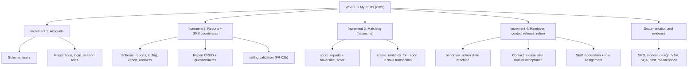

# Software Project Management

Where Is My Stuff? GPS-enabled Lost and Found System. CS-326 evidence for planning, scheduling, and agile development.

Timeline anchor points that can be verified from the repository: TODO.md resumed 8 September 2026; scope-freeze.md checkpoint 12 September 2026 (GPS prototype). The project has no version-control history, so all dates below are the recorded document dates.

## 1. Work breakdown structure

The product is decomposed into four increments plus a specialised GPS increment, matching the plan in `CS-326-SE-Project-Plan.md`.

## 2. Schedule

| Increment | Deliverable | Planned | Recorded state (12 Sep 2026) |
|---|---|---|---|
| 1 Accounts | users schema, auth.php, logout.php | 8 Sep | Complete (TODO.md) |
| 2 Reports + GPS | reports + report_answers schema, CRUD, lat/lng, questionnaires | 8-9 Sep | Complete |
| 3 Matching | score_reports, haversine bands, same-user exclusion | 9-10 Sep | Complete |
| 4 Handover | workflow.php state machine, contacts, return, moderation | 10-11 Sep | Complete |
| 5 Verification | scoring tests, isolated HTTP tests, browser pass | deferred | Pending (scope-freeze item 4) |
| 5b Optional map | Leaflet.js display | deferred | Pending (scope-freeze item 5) |

Effort estimates per task are given in `cost-estimation.md`. This table is a plan record; actual effort spent is not separately logged (open item: keep an hours log for the final report).

### 2.1 Milestones

| Milestone | Entry | Exit criteria |
|---|---|---|
| Accounts | 8 Sep 2026 | register/login/logout with role refresh works |
| Reports | 9 Sep 2026 | report saved with lat/lng and full questionnaire |
| Matching | 10 Sep 2026 | eligible pairs appear with score breakdown |
| Handover | 11 Sep 2026 | mutual acceptance, contacts, return closed |
| Demo checkpoint | 12 Sep 2026 | scope-freeze.md checkpoint recorded |
| Submission | TBD | all V&V evidence executed and recorded |

## 3. Agile development evidence

The project follows an incremental process and borrows the practices it can honestly claim from XP and Scrum.

| Agile element | Practice | Evidence in repo |
|---|---|---|
| Backlog | Prioritised implementation checklist | TODO.md (requirements mapped in srs.md traceability) |
| Small releases | Four increments, each reviewed before the next | CS-326-SE-Project-Plan.md, schedule above |
| Continuous integration | Syntax gate + self-contained scoring test | `php -l` on every file; tests/matching_test.php |
| Refactoring | Matching rules moved into matching.php, workflow writes into workflow.php | scope-freeze.md change table |
| Sprint planning | Increment goals set before starting | CS-326-SE-Project-Plan.md increments table |
| Sprint review | Recorded change checkpoint | scope-freeze.md (GPS scope change, 12 Sep 2026) |
| Retrospective | Lessons recorded after the GPS change | maintenance-record.md section 5 |
| Pair programming / standups | Not practised (single developer) | Open item: note this honestly in the report |

### 3.1 Sprint record (GPS change, 12 Sep 2026)

Planning: extend to Karachi-wide scope with coordinates and haversine scoring.

Review outcome: schema, scoring, form, and handover text were changed; the two test suites were not updated and now fail against haversine scoring. This is recorded as a defect in verification-and-validation.md.

Retrospective: the scoring change was released before its tests were updated, which is the single largest rework risk the project hit. Lesson: gate the scope-freeze increments on their test update.

## 4. Communication and reporting plan

| Audience | Channel | Frequency |
|---|---|---|
| Course instructor | Demo at checkpoint | Per increment |
| Project documentation | scope-freeze.md, TODO.md, these SE documents | Continuously updated |
| NED stakeholders | Demo scenario (README demo journey) | Submission |

## 5. Open items for submission

- Gantt chart export (mermaid timeline or draw.io) showing the schedule in 2.1.
- Actual effort hours log to feed the COCOMO estimate.
- Stakeholder sign-off on the SRS (srs.md section 8).