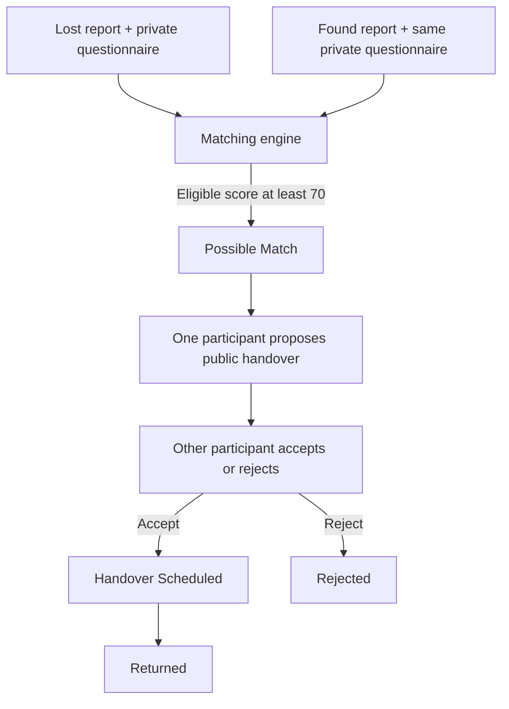
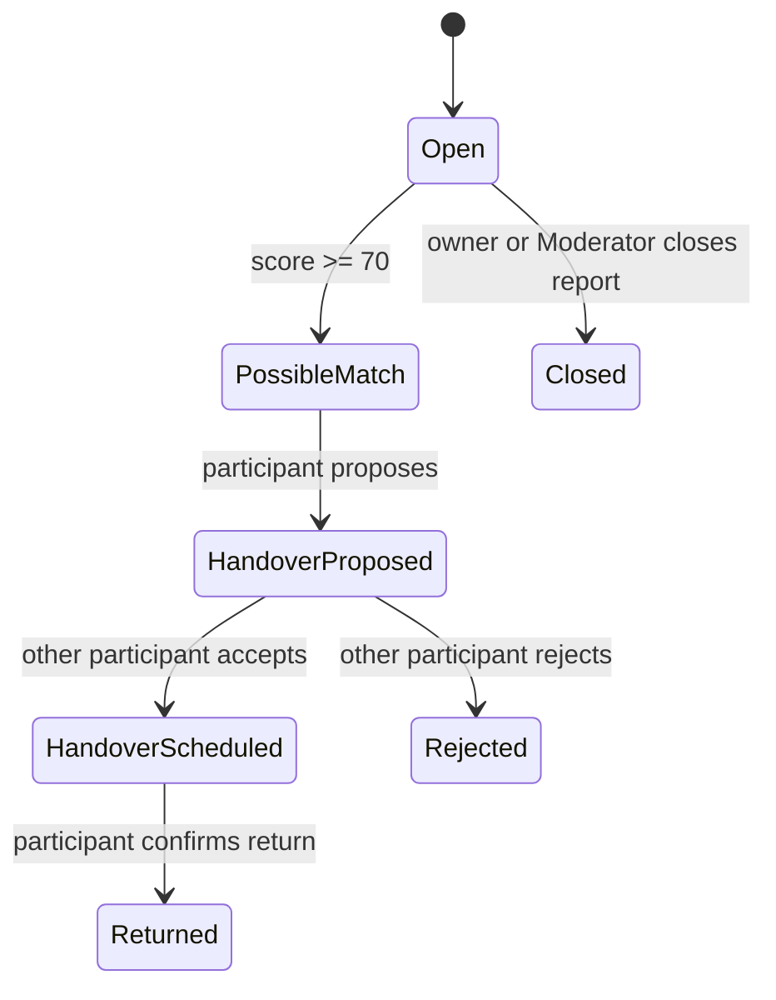

# Where Is My Stuff? Matching Architecture

## Frozen decision

This is the approved matching design for the CS-326 Software Engineering project. The application does not use an LLM at runtime. It uses deterministic rules that can be tested, explained, and measured. This document describes both the NED-only frozen baseline and the Karachi-wide GPS variant; the GPS variant replaces the fixed NED location dropdown with haversine distance bands computed from stored latitude/longitude.

Both the Lost reporter and the Finder complete the same category-specific questionnaire. The system privately compares the reports, produces a ranked possible match, and records a mutual public handover.

## Roles

| Role | Responsibility |
|---|---|
| Student | Creates Lost and Found reports, completes questionnaire answers, proposes or accepts a handover. |
| Finder | The Student who filed the Found report. The Finder does not manually calculate a match. |
| Moderator | Reviews suspicious or invalid reports and can close an active report. Does not review every match or see private answers by default. |
| Admin | Assigns user roles and has Moderator access. |

## Matching workflow

The system does not guarantee a physical meeting. It records that both participants accepted the same public handover proposal and later records the returned status.

## Candidate eligibility

A pair is compared only when all conditions hold:

- One report is `Lost` and the other is `Found`.
- The reports have different `user_id` values.
- Both reports are active.
- Their categories are identical.
- At least two private questionnaire answers agree.

The same user may file both Lost and Found reports, but their own reports are never compared with each other.

## Explainable 100-point algorithm

| Factor | Rule | Maximum |
|---|---|---:|
| Category | Exact category equality | 20 |
| Location | Haversine distance bands from stored lat/lng: <0.5km: 20, <1km: 15, <2km: 10, <5km: 5, further: 0 | 20 |
| Date | Same day: 15; within 1 day: 10; within 3 days: 5 | 15 |
| Description | Meaningful-word Jaccard similarity × 15 | 15 |
| Questionnaire | Equal private answers share a normalized 30-point allocation | 30 |
| **Total** |  | **100** |

A total score of **70 or higher** creates a Possible Match. The match record stores every factor score and the number of private fields that agree. The user interface may show a category-specific agreement count, but never the private values.

### Comparison rules

- Select, yes/no, range, and masked-suffix values must match exactly after trimming and lowercasing.
- Description text is converted to lowercase words, common words are removed, and similarity is calculated as shared meaningful words divided by all meaningful words in both descriptions.
- A questionnaire answer is private. It is used by the server for scoring and is not displayed in dashboards, staff report lists, or another unrelated user's HTML.
- Public descriptions are checked for likely contact and identity/card identifiers before saving; unsafe descriptions are rejected rather than silently truncated.

## Category questionnaires

Each report requires all applicable category-specific answers. Inputs use selects, yes/no values, conditional text fields, count ranges, and masked suffixes so comparison stays deterministic. Conditional fields are stored as `Not provided` when their parent answer is No.

| Category | Private fields |
|---|---|
| Wallet / Purse | Colour, material, visible-logo presence and name, CNIC/NIC presence and last three digits, bank-card presence and last four digits, distinguishing-mark type |
| Cards / IDs | Card type, issuer, colour, masked suffix, visible-mark type |
| Keys | Key-count range, keyring colour, key type, fob type, visible marking |
| Electronics | Device type, brand, colour, case type, visible damage type |
| Bag | Bag type, colour, material, pocket-count range, tag type |
| Documents | Document type, issuer, cover colour, folder type, visible mark type |
| Cash / Money | Amount range, denomination group, holder type, holder colour, fold/band type |
| Other | Colour, material, size range, attached-part type, visible-mark type |

For privacy, the Cards / IDs category stores only a masked suffix:

- CNIC/NIC: last **three** digits only when the report says one is present.
- Bank card or NED card: last **four** digits only.
- Full CNIC, bank-card, and student-card numbers are prohibited. Demo records use invented values.

## Public handover

After a Possible Match, either participant proposes one handover record:

- Location: `NED Security Office` or `Department Office` (in the Karachi-wide GPS variant: free-form text, any safe meeting point).
- Date and time.
- Proposer identity and timestamp.

The proposer is automatically marked as accepting the proposal. The other participant accepts or rejects the exact same location and time. When both accept, the system changes the match to `Handover Scheduled` and reveals saved contact details. Either participant may mark the handover `Returned` afterward.

## Data design

| Table | Purpose |
|---|---|
| `users` | Account details and role: Student, Moderator, or Admin. |
| `reports` | Public Lost/Found report details, creator, category, date, location, and status. |
| `report_answers` | Five private structured answers per report: `report_id`, `field_key`, and `answer_value`. |
| `matches` | Pair of reports, each score factor, private-field match count, lifecycle status, and both acceptance timestamps. |
| `handovers` | One public handover proposal per match: proposer, location, time, and status. |

This normalized design removes the old single private-question and legacy claim workflow.

## State model

## Verification and validation

The following test cases are required before the demo:

- Same-category reports with matching answers score 70 or higher.
- Different categories never match.
- Reports from one account never match each other.
- Only one private-field agreement fails candidate eligibility.
- Same date, one-day difference, and three-day difference receive correct date scores.
- Private fields do not appear in public, dashboard, or unrelated-user responses.
- Both participants must accept the same handover before status becomes Handover Scheduled.
- Student users cannot open management pages; Moderators cannot change roles; Admins can.
- Full CNIC and full card numbers are rejected.

For CS-326 evidence, record test input, expected score, actual score, pass/fail result, defects found, and actual fix time. This demonstrates requirements engineering, design, V&V, SQA metrics, risk management, and maintenance beyond basic CRUD.

## Future work

An LLM could later rank description similarity after the deterministic eligibility filter. It is intentionally outside this version because it needs an API or local model, privacy controls, fallback behavior, evaluation data, and separate reliability testing.
